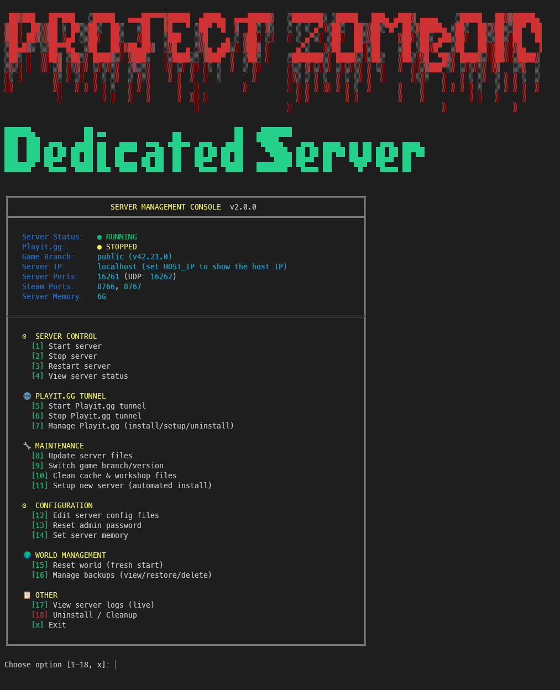

# 🧟 Project Zomboid Dedicated Server Manager


A comprehensive, beautiful CLI management suite for Project Zomboid dedicated servers on Linux.

## 📑 Table of Contents

- [TL;DR](#-tldr)
- [Features](#-features)
- [Installation](#-installation)
- [Using an Existing Server](#-using-an-existing-server)
- [Usage](#-usage)
- [File Structure](#-file-structure)
- [Configuration](#-configuration)
- [Playit.gg Tunneling](#-playitgg-tunneling)
- [Troubleshooting](#-troubleshooting)
- [Updating the Server](#-updating-the-server)
- [Uninstallation](#-uninstallation)
- [Quick Reference](#-quick-reference)
- [TODO / Roadmap](#-todo--roadmap)
- [Versions & Releases](#-versions--releases)
- [License](#-license)

## ⚡ TL;DR

1. ```bash
   git clone https://github.com/uka-it/pzserver-manager.git
   cd pzserver-manager
   ./server-manager.sh
   ```
2. Inside the menu pick **`[11] Setup new server`** to run the guided installer.
3. Use **`[1] Start server`** whenever you want to bring it online.
4. Need a tunnel? Choose **`[7] Manage Playit.gg`** (start/stop/install/tunnels/logs).

Everything else in the menu is optional maintenance.


## ✨ Features

### 🎮 Beautiful CLI Interface
- **Retro ASCII Art** - Red Project Zomboid logo with CRT green "Dedicated Server"
- **Color-Coded Menus** - Cyan borders, yellow headers, green options
- **Real-time Status** - Live server/tunnel status display
- **Interactive Prompts** - User-friendly navigation




### 🚀 Automated Setup
- **One-Command Installation** - Complete server setup from scratch
- **Dependency Management** - Auto-installs SteamCMD, Playit.gg, system packages
- **Branch Selection** - Choose from available branches.
- **Configuration Wizard** - Interactive server configuration

### 🔧 Server Management
- **Start/Stop/Restart** - Full server control with background execution
- **Branch Switching** - Dynamic branch selection from Steam
- **Auto-Updates** - Update to latest version of current branch
- **Cache Cleaning** - Remove workshop files, logs, backups

### 🌍 World Management
- **World Reset** - Fresh start with backup option
- **Backup Manager** - View, restore, delete world backups
- **Safe Restoration** - Auto-creates safety backup before restore

### 📊 Monitoring
- **Live Logs** - View server/console logs with `less +F`
- **Status Dashboard** - Server, Playit.gg, branch info
- **Log Viewer** - Server output, game console, or combined view

### 🌐 Network Tunneling
- **Playit.gg Integration** - Optional tunneling for CGNAT/NAT
- **Playit Manager** - Dedicated management menu
  - Start/Stop tunnel independently
  - View claim URL for account activation
  - Configure tunnels
  - View tunnel logs
- **Status Monitoring** - Real-time tunnel status
- **Works Without Playit** - Server runs fine with direct connection

### 🗑️ Uninstall / Cleanup
- **Selective Removal** - Choose what to uninstall
- **Server Files Only** - Remove installation, keep world data
- **World Data Only** - Fresh world, keep server files
- **Playit.gg Only** - Remove tunneling service
- **Complete Uninstall** - Remove everything

## 📦 Installation

### Prerequisites
- Debian/Ubuntu Linux
- Sudo access
- Internet connection

### Quick Start

```bash
# 1. Clone the repository
git clone https://github.com/uka-it/pzserver-manager.git
cd pzserver-manager

# 2. Run the server manager
./server-manager.sh

# 3. Choose option [11] Setup new server
```

The setup wizard will guide you through:
1. Installing system dependencies (lib32gcc-s1, curl)
2. Installing SteamCMD
3. Configuring your server (name, password, ports, etc.)
4. Selecting game branch
5. Downloading Project Zomboid server files

**Smart Configuration:**
- If you're reinstalling, the wizard will detect your existing `.env` file
- You can choose to reuse your previous settings (skips all configuration questions)
- Or create a new configuration from scratch
- Admin password is automatically reset on reinstall to ensure it applies correctly

After setup, use option `[1]` to start your server!

For advanced configuration options, see [CONFIGURATION.md](CONFIGURATION.md)

### Manual Installation

If you prefer manual setup:

```bash
# 1. Clone repository
git clone https://github.com/yourusername/pzserver-manager.git
cd pzserver-manager

# 2. Make scripts executable
chmod +x *.sh

# 3. Install dependencies
sudo apt update
sudo apt install -y lib32gcc-s1 curl

# 4. Run setup
./setup-new-server.sh
```

### 🐳 Docker

Runs the server and the manager in a container (x86_64 hosts only). Set your values in `docker-compose.yml` (at least `ADMIN_PASSWORD`), then:

```bash
docker compose up -d --build     # first start downloads the game (~3-5 GB)
docker compose logs -f           # follow the server log
docker exec -it pzserver ./server-manager.sh   # open the management menu
docker compose stop              # graceful stop (world is saved)
```

- The environment variables in `docker-compose.yml` are only used for the **first** install. After that, change settings from the menu (they live in `~/manager/.env` inside the container).
- `PZ_BRANCH` picks the game branch (`public` or a beta name such as `unstable`).
- Data is kept in named volumes: `pz-saves` (worlds, `pzserver.ini`, player DB, so **back this one up**), `pz-server` (game files) and `pz-home` (manager state, playit and Steam config).
- Game ports are **UDP** (`16261/udp`, `16262/udp`, `8766/udp`, `8767/udp`). If you only use Playit.gg you can remove the `ports:` section.
- Stopping/restarting the server from the menu keeps the container running; `docker compose stop` shuts the server down gracefully.
- Set `HOST_IP` to show the right address in the menu. Inside a container `hostname -I` only sees the internal Docker IP.
- Memory: set `SERVER_MEMORY` (e.g. `6G`) for the first install, or leave it empty to use the recommended value (container RAM minus 2G, max 8G). Change it later with menu option `[14]`. Make sure Docker has enough RAM available.

## 🔄 Using an Existing Server

The manager can take over a Project Zomboid server you already run, with or without Docker. Your world, players, admin account and server settings are kept.

### 1. Collect a few facts from your current server

```bash
ls ~/Zomboid/Server/*.ini
```

- **Server name**: the file name without `.ini` (`myserver.ini` → `myserver`). The manager calls this `PZ_SERVER_NAME`; it also names `Saves/Multiplayer/<name>/` and `db/<name>.db`. The default is `pzserver`.
- **Game version**: the new install must use the **same branch** as your world. A Build 41 world won't load on Build 42; for Build 41 use `legacy41`. Run `./list-branches.sh` (or `[9]` in the menu) to see the current branches.
- **Ports**: if you changed them, note `DefaultPort` and `UDPPort` from the `.ini`.

### 2. Stop the old server and back it up

Stop it the way you normally do (screen, tmux, systemd, …) and disable anything that starts it automatically (a systemd service or cron job), or it will fight the manager over the ports and files. Then back up your data:

```bash
tar czf ~/zomboid-backup.tar.gz -C ~ Zomboid
```

### 3a. Without Docker

Run the manager as the same Linux user that owns `~/Zomboid` (not root):

```bash
git clone <repo-url> pzserver-manager && cd pzserver-manager
chmod +x *.sh
cp .env.example .env
nano .env               # set PZ_SERVER_NAME, ports, SERVER_MEMORY and INSTALL_DIR
                        # (where your game files are), and delete the ADMIN_PASSWORD line
touch .admin_created    # your admin account already exists
./server-manager.sh     # [1] Start server
```

### 3b. With Docker

**Configure** `docker-compose.yml` (in the `environment:` section):

```yaml
PZ_SERVER_NAME: "myserver"   # from step 1
PZ_BRANCH: "public"          # must match your world, e.g. "legacy41" for Build 41
SERVER_MEMORY: "8G"
HOST_IP: "192.168.1.50"      # this machine's LAN IP (optional, only for display)
```

`SERVER_NAME`, `SERVER_DESCRIPTION`, `MAX_PLAYERS` and `ADMIN_PASSWORD` are not used here: your existing `.ini` and admin account are kept. If you use **custom ports**, also add `DEFAULT_PORT` and `STEAM_PORT1` and change the `ports:` mappings to match (for game port 16300: `16300:16300/udp` and `16301:16301/udp`).

**Copy your data** into the Docker volume, before the first start:

```bash
docker compose create                   # creates the container and empty volumes
docker volume ls | grep pz-saves        # the name starts with the repo folder, e.g. pzserver-manager_pz-saves
docker run --rm -v pzserver-manager_pz-saves:/dest -v ~/Zomboid:/src alpine \
    sh -c "cp -a /src/. /dest/ && chown -R 1000:1000 /dest"   # the container runs as UID 1000
```

If the old server is on another machine, copy its `Zomboid` folder over first (for example with `scp -r`) and use that path as the source. On Windows, run the command on one line in PowerShell with a Windows path, e.g. `-v C:\path\to\Zomboid:/src`.

**Start** it and follow the log:

```bash
docker compose up -d
docker compose logs -f
```

On the first start you should see the game files download (~7 GB), then `Existing server configuration found … Keeping existing configuration unchanged` and `Existing player database found - keeping its admin account`. Workshop mods from your `.ini` download next, then `*** SERVER STARTED ***`.

### 4. Check that it worked

Open the menu (`./server-manager.sh`, or `docker exec -it pzserver ./server-manager.sh` with Docker):

- `[4]` status: server **RUNNING** and the game port **listening**
- `[12]` edit config: your config files are found (✓)
- Join the game with your usual admin login and check your world, characters and settings

### Troubleshooting and rollback

- **World doesn't load or the server keeps stopping**: check the log (`docker compose logs --tail 200`, or `[17]` in the menu). Usually `PZ_BRANCH` doesn't match the version of your world.
- **Go back to the old server**: stop the manager (`docker compose down`, or `[2]` in the menu) and start your old server as before. With Docker your original files were only copied, never changed; without Docker restore your backup from step 2 if needed.
- **Start the Docker migration over**: `docker compose down -v` deletes the volumes; then repeat step 3b.

Running setup (`[11]`) on an existing server is also safe: it backs up your `<name>.ini` and only updates the name, description, max players and ports; every other setting is kept.

## 🎯 Usage

### Main Menu

Launch the management console:

```bash
./server-manager.sh
```

**Menu Options:**

**⚙ SERVER CONTROL**
- `[1]` Start server
- `[2]` Stop server
- `[3]` Restart server
- `[4]` View server status

**🌐 PLAYIT.GG TUNNEL**
- `[5]` Start Playit.gg tunnel
- `[6]` Stop Playit.gg tunnel
- `[7]` Manage Playit.gg (install/setup/tunnels/logs)

**🔧 MAINTENANCE**
- `[8]` Update server files
- `[9]` Switch game branch/version
- `[10]` Clean cache & workshop files
- `[11]` Setup new server (automated install)

**⚙️ CONFIGURATION**
- `[12]` Edit server config files (INI, sandbox, spawn points)
- `[13]` Reset admin password
- `[14]` Set server memory (how much RAM the server may use)

**🌍 WORLD MANAGEMENT**
- `[15]` Reset world (fresh start)
- `[16]` Manage backups (create/restore/delete)

**📋 OTHER**
- `[17]` View server logs (live)
- `[18]` Uninstall / Cleanup
- `[x]` Exit

That's it! Everything is accessible through the main menu.

For advanced users who want to run individual scripts directly, see [CONFIGURATION.md](CONFIGURATION.md).

## 📁 File Structure

```
pzserver-manager/
├── README.md                   # This file
├── CONFIGURATION.md            # Advanced configuration guide
├── server-manager.sh           # Main management console ⭐ Start here!
├── setup-new-server.sh         # Automated installation wizard
├── edit-server-config.sh       # Config file editor (INI, Lua, spawn files)
├── start-all.sh                # Start server + Playit.gg
├── stop-all.sh                 # Stop all services
├── status.sh                   # Show server status
├── list-branches.sh            # Game branch switcher
├── update-server.sh            # Update server files
├── clean-cache.sh              # Cache/workshop cleaner
├── reset-world.sh              # World reset tool
├── manage-backups.sh           # Backup manager (create/restore/delete)
├── manage-playit.sh            # Playit.gg tunnel manager
├── uninstall.sh                # Uninstall/cleanup tool
└── lib/                        # Shared UI components
    └── ui-box.sh               # Box-drawing functions
```

## 🔑 Configuration

The setup wizard will ask you to configure:

- **Server Name** - Shown to players (default: "My PZ Server")
- **Admin Password** - For admin commands (default: "changeme123")
- **Max Players** - Maximum concurrent players (default: 32)
- **Game Port** - Main server port (default: 16261 UDP)
- **Steam Ports** - Authentication ports (default: 8766, 8767 UDP)
- **Game Branch** - Select available game branch from Steam

**⚠️ IMPORTANT:** To change admin password after setup, use option `[12] Edit server config files` from the main menu.

### Editing Server Configuration

Use option `[12]` from the main menu to edit server configuration files:

**Available Files:**
- **Server Configuration** (`pzserver.ini`) - Server name, password, ports, max players, PVP settings
- **Sandbox Variables** (`pzserver_SandboxVars.lua`) - Gameplay settings, zombie spawns, loot, difficulty
- **Spawn Points** (`pzserver_spawnpoints.lua`) - Player spawn locations
- **Spawn Regions** (`pzserver_spawnregions.lua`) - Spawn region definitions

**Features:**
- Opens files in nano editor
- Automatic backup before editing (`.backup-YYYYMMDD-HHMMSS`)
- Warns if server is running
- Shows which files exist/missing
- Confirms when changes are saved

**Usage:**
```bash
./server-manager.sh → [12] → Select file → Edit in nano → Save (Ctrl+X, Y)
```

## 🌐 Playit.gg Tunneling

If you're behind CGNAT/NAT, use Playit.gg for tunneling:

### Manage Playit.gg

```bash
./server-manager.sh
# Choose [6] Manage Playit.gg
```

**Options:**
1. Start Playit.gg tunnel
2. Stop Playit.gg tunnel
3. Restart tunnel
4. View active tunnels
5. **Get claim URL / Manage account** - Activate and manage your tunnel
6. Setup new tunnels
7. View Playit.gg logs
8. Back to main menu

### Initial Setup

1. Run: `playit setup` or use option [6] → [6] from the manager
2. **Get claim URL** - Visit the URL to activate your account
3. Create 4 UDP tunnels:
   - Port 16261 → Main server
   - Port 16262 → Secondary
   - Port 8766 → Steam 1
   - Port 8767 → Steam 2

4. Share your Playit.gg address with players:
   ```
   your-tunnel.gl.at.ply.gg:PORT
   ```

### Start Options

**With Tunnel:**
```bash
./server-manager.sh → [1] Start server + Playit.gg
```

**Without Tunnel:**
```bash
./server-manager.sh → [2] Start server only
```

## 🎨 Features Showcase

### Beautiful ASCII Art Header
```
Red "PROJECT ZOMBOID" logo + Green CRT "Dedicated Server" subtitle
```

### Color-Coded Status
- 🟢 Green: Server RUNNING
- 🔴 Red: Server STOPPED
- 🟡 Yellow: Playit.gg STOPPED

### Branch Auto-Detection
Shows the installed Steam branch and the actual game version reported by the server, e.g. `public (v42.21.0)`

### Dynamic Size Calculation
Cache cleaner shows actual sizes, not hardcoded values

### Log Viewer with 'q' to Exit
No more Ctrl+C issues - press 'q' to return to menu

## 🛠️ Troubleshooting

### Server won't start
```bash
# Check logs
tail -50 server.log

# Or use the menu
./server-manager.sh
# Choose [11] View server logs
```

### Playit.gg not working
```bash
# Check if running
pgrep playit

# Restart
pkill playit
playit start
```

### Branch switch failed
```bash
# Verify current branch
cat steamapps/appmanifest_380870.acf | grep BetaKey

# Clean and retry
./clean-cache.sh
./list-branches.sh
```

### Port conflicts
```bash
# Check what's using ports
sudo lsof -i :16261
sudo lsof -i :16262
```

## 📝 Logs Location

- **Server output:** `~/pzserver/server.log`
- **Playit.gg:** `~/pzserver/playit.log`
- **Game console:** `~/Zomboid/Logs/*/console.txt`

## 🔄 Updating the Server

The manager will auto-detect your current branch and update to the latest version:

```bash
./server-manager.sh
# Choose [5] Update server files
```

Or directly:
```bash
./update-server.sh
```

## 🗑️ Uninstallation

Use the built-in uninstall script with options:

```bash
./server-manager.sh
# Choose [12] Uninstall / Cleanup

# Or run directly:
./uninstall.sh
```

**Options:**
1. Server files only - Remove installation, keep worlds
2. World data only - Fresh world, keep server
3. Playit.gg only - Remove tunneling
4. Everything - Complete removal

The uninstall script will:
- Stop all running services
- Show sizes before removal
- Ask for confirmation
- Provide detailed feedback

## 📋 TODO / Roadmap

Planned features and improvements:

- **Multiple Server Instances** - Ability to create and manage multiple server installations/instances from a single manager
  - Separate configuration for each instance
  - Easy switching between server instances
  - Independent start/stop/update for each server

Contributions and suggestions welcome!

## 🔖 Versions & Releases

The manager version is shown in the main menu and stored in the `VERSION` file. Every release is listed on the [Releases page](https://github.com/uka-it/pzserver-manager/releases) with its changes; see [CHANGELOG.md](CHANGELOG.md) for the full history.

To use a specific version, download it from the Releases page or check out its tag:
```bash
git checkout v2.0.0
```

**Making a release** (for maintainers):
1. Update `VERSION` and add a section for the new version to `CHANGELOG.md`
2. Commit, then tag and push: `git tag v2.1.0 && git push origin main v2.1.0`
3. The GitHub Actions workflow checks the scripts, verifies `VERSION` matches the tag and publishes the release using the `CHANGELOG.md` section as release notes

## 🤝 Contributing

Contributions welcome! Please feel free to submit a Pull Request.

## 📄 License

**CC BY-NC-SA 4.0** - Creative Commons Attribution-NonCommercial-ShareAlike 4.0 International

### ✅ You ARE allowed to:
- Use for personal/non-commercial purposes
- Modify and improve the code
- Share with others
- Create derivative works

### ❌ You are NOT allowed to:
- Use commercially without permission
- Sell or profit from this software
- Use in commercial products/services

### 💼 Commercial Licensing
For commercial use, please contact the author for licensing arrangements.

See [LICENSE](LICENSE) file for full terms.

## 🙏 Credits

- **Project Zomboid** - The Indie Stone
- **Playit.gg** - Tunneling service
- **SteamCMD** - Valve Corporation

## 📞 Support

- **Issues:** [GitHub Issues](https://github.com/yourusername/pzserver-manager/issues)
- **Wiki:** [Project Zomboid Wiki](https://pzwiki.net/wiki/Dedicated_server)

## ⚡ Quick Reference

```bash
# Start server
./server-manager.sh → [1]

# Stop server
./server-manager.sh → [2]

# Edit server config
./server-manager.sh → [12]

# View logs
./server-manager.sh → [15] → [1/2/3]

# Switch branch
./server-manager.sh → [9]

# Create backup
./server-manager.sh → [14] → [1]

# Reset world
./server-manager.sh → [13]
```

---

**Made with 💀 for the Project Zomboid community**


